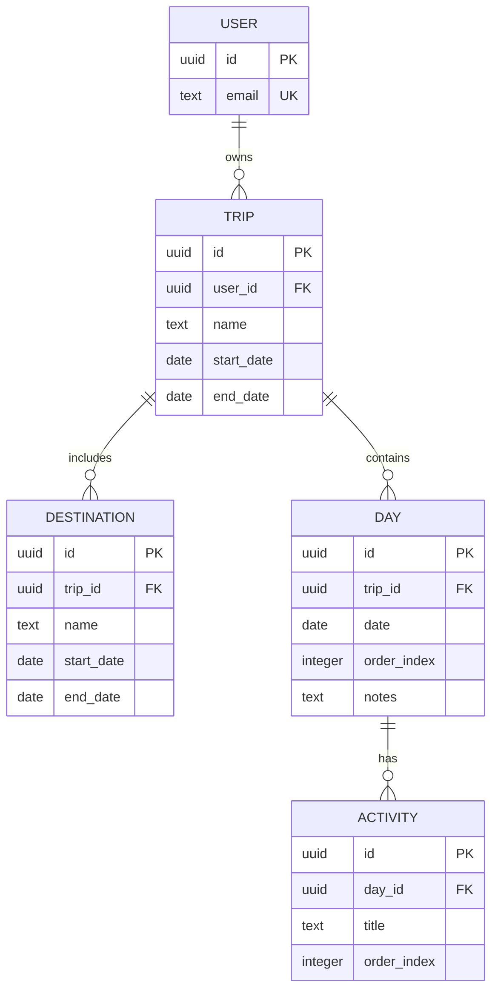

# Trip Planner — Data & API Design

> **When:** Week 3 (Sections 0–2), Week 4 (Sections 3–4) · **Owner:** Architecture Lead (Data & API owner) · **Done when:** every item in the SVC Self-Check at the end is true.
>
> **Version:** 1.0
>
> **Approved on:** 11/12/2026 **by:** Architecture Lead ___ · Product Owner ___ · Delivery Lead MM

This document turns the Spec's nouns into data and its user actions into endpoints. If the built app and this document disagree, this document wins until it's deliberately changed. Unresolved questions are called out below and in the Spec's Open Questions.

---

## 0. Database & Storage

**Database:** PostgreSQL via Supabase

**Build option:** Simulated backend

**We store:** Users, trips, destinations, itinerary days, and activities required to plan and reopen trips. The app remembers each trip's name, date range, destination details, and day-by-day itinerary so users can view and edit a saved trip after returning.

**We do NOT store:** Passwords, the login is simulated with email only. We do not store payment, booking, or collaboration data because those features are out of scope.

**Sensitive fields:** `user.email` , used only to identify the simulated user and not exposed beyond the logged-in session.

*This design assumes a relational model, which matches the requirement for one table per entity and the day-by-day planning flow in the app.*

---

## 1. Entities

**Entity: User**

| Field | Type | Key | Required? | Req ID |
|-------|------|-----|-----------|--------|
| id | uuid | PK | Yes | R1, R5, R7 |
| email | text | Unique | Yes | R1, R7 |

**Entity: Trip**

| Field | Type | Key | Required? | Req ID |
|-------|------|-----|-----------|--------|
| id | uuid | PK | Yes | R1, R5, R8, R9 |
| user_id | uuid | FK → User (on delete: block) | Yes | R1, R5 |
| name | text | | Yes | R1, R2, R5, R9, R10 |
| start_date | date | | Yes | R1, R2, R5, R9 |
| end_date | date | | Yes | R1, R2, R5, R9 |

**Entity: Destination**

| Field | Type | Key | Required? | Req ID |
|-------|------|-----|-----------|--------|
| id | uuid | PK | Yes | R3, R9 |
| trip_id | uuid | FK → Trip (on delete: delete children too) | Yes | R3, R9 |
| name | text | | Yes | R3, R9 |
| start_date | date | | Yes | R3, R9 |
| end_date | date | | Yes | R3, R9 |

**Entity: Day**

| Field | Type | Key | Required? | Req ID |
|-------|------|-----|-----------|--------|
| id | uuid | PK | Yes | R4, R9, R10, R11 |
| trip_id | uuid | FK → Trip (on delete: delete children too) | Yes | R4, R9, R10, R11 |
| date | date | | Yes | R4, R9, R10, R11 |
| order_index | integer | | Yes | R4, R9, R11 |
| notes | text | | No | R4 |

**Entity: Activity**

| Field | Type | Key | Required? | Req ID |
|-------|------|-----|-----------|--------|
| id | uuid | PK | Yes | R4, R9, R11 |
| day_id | uuid | FK → Day (on delete: delete children too) | Yes | R4, R9, R11 |
| title | text | | Yes | R4, R9, R11 |
| order_index | integer | | Yes | R4, R9, R11 |

---

## 2. Entity Relationship Diagram (ERD)

---

## 3. Normalization Check

- [x] **1NF** — every field holds one value; there are no comma-separated values, arrays, or repeated columns.
- [x] **2NF** — every non-key field depends on the full primary key for its entity; `activity.title` depends on `activity.id`, `destination.name` depends on `destination.id`, and so on.
- [x] **3NF** — no field depends on another non-key field. The trip's date range is stored on `Trip`; day and destination dates are not duplicated into related records beyond their own row.

**Intentional exceptions:** None.

---

## 4. API Endpoints

The app uses a simple authenticated API for trip planning. Logged-in users can create trips, add destinations, and build a day-by-day itinerary. The UI handles save warnings and undo actions, while the API stores the real trip data.

| Req ID | Method | Path | Request | Success response | Errors | Who can call it |
|--------|--------|------|---------|------------------|--------|-----------------|
| R7 | POST | /v1/login | `{ "email": "user@example.com" }` | `200 { "user": { "id", "email" } }` | `400` missing email | Anyone |
| R5 | GET | /v1/me | — | `200 { "id", "email" }` | `401` | Member |
| R7 | POST | /v1/logout | — | `204` | — | Member |
| R5 | GET | /v1/trips | — | `200 [{ "id", "name", "start_date", "end_date" }]` | `401` | Member |
| R1 | POST | /v1/trips | `{ "name", "start_date", "end_date" }` | `201 { "id", "user_id", "name", "start_date", "end_date" }` | `400`, `401` | Member |
| R5 | GET | /v1/trips/{id} | — | `200` full trip details with destinations, days, and activities | `401`, `404` | Member |
| R11 | DELETE | /v1/trips/{id} | — | `204` | `401`, `404` | Member |
| R9 | PATCH | /v1/trips/{id} | `{ "name?", "start_date?", "end_date?" }` | `200` updated trip | `400`, `401`, `404` | Member |
| R3 | POST | /v1/trips/{id}/destinations | `{ "name", "start_date", "end_date" }` | `201 { "id", "trip_id", "name", "start_date", "end_date" }` | `400`, `401`, `404` | Member |
| R9 | PATCH | /v1/trips/{id}/destinations/{destination_id} | `{ "name?", "start_date?", "end_date?" }` | `200` updated destination | `400`, `401`, `404` | Member |
| R9 | DELETE | /v1/trips/{id}/destinations/{destination_id} | — | `204` | `401`, `404` | Member |
| R4 | POST | /v1/trips/{id}/days | `{ "date", "notes?", "order_index" }` | `201 { "id", "trip_id", "date", "notes", "order_index" }` | `400`, `401`, `404` | Member |
| R9 | PATCH | /v1/trips/{id}/days/{day_id} | `{ "date?", "notes?", "order_index?" }` | `200` updated day | `400`, `401`, `404` | Member |
| R9 | DELETE | /v1/trips/{id}/days/{day_id} | — | `204` | `401`, `404` | Member |
| R4 | POST | /v1/trips/{id}/days/{day_id}/activities | `{ "title", "order_index" }` | `201 { "id", "day_id", "title", "order_index" }` | `400`, `401`, `404` | Member |
| R9 | PATCH | /v1/trips/{id}/days/{day_id}/activities/{activity_id} | `{ "title?", "order_index?" }` | `200` updated activity | `400`, `401`, `404` | Member |
| R11 | DELETE | /v1/trips/{id}/days/{day_id}/activities/{activity_id} | — | `204` | `401`, `404` | Member |

Simple notes:
- `GET /v1/trips` shows the list of saved trips on the home page. Upcoming trips appear first.
- `GET /v1/trips/{id}` returns the full trip, including destinations and itinerary days, so the app can render one trip in one request.
- Validation errors use `400` with a simple field message, such as `{"field":"end_date","message":"required"}`.
- The app uses a client-side save warning and undo flow for `R6`, `R10`, and `R11`.

---

## SVC Self-Check

- [x] **Simple** — entities are plain nouns from the Spec; endpoint paths are nouns and HTTP verbs describe the action (`GET /v1/trips`, not `/getTrips`).
- [x] **Valuable** — every field and endpoint has a requirement ID; sensitive fields are called out and protected; the data model is limited to trip-planning needs only.
- [x] **Complete** — the database model reflects the simulated backend plan; all P1 requirements that store or read data have an entity and endpoint; every FK has a delete rule; the ERD shows cardinality; the normalization check is complete; every endpoint names the caller; the document identifies the missing database decision as TBD.
